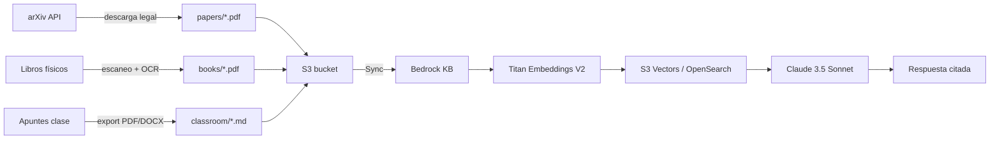

# 🤖 RAG Robotics & AI — AWS Knowledge Base

> Sistema de Retrieval-Augmented Generation (RAG) sobre bibliografía de robótica,
> control de manipuladores e IA aplicada a robots, construido sobre Amazon Bedrock.

[](https://aws.amazon.com/bedrock/)
[](https://www.python.org/)
[](LICENSE)
[]()
[]()
[]()

---

## 📑 Tabla de contenidos

- [Visión general](#-visión-general)
- [Arquitectura](#-arquitectura)
- [Estructura del repositorio](#-estructura-del-repositorio)
- [Pipeline completo](#-pipeline-completo)
- [Requisitos](#-requisitos)
- [Instalación paso a paso](#-instalación-paso-a-paso)
- [Uso](#-uso)
- [Costos estimados](#-costos-estimados)
- [Solución de problemas](#-solución-de-problemas)
- [Disclaimer legal](#-disclaimer-legal)
- [Licencia](#-licencia)

---

## 🎯 Visión general

Este proyecto implementa un **sistema RAG (Retrieval-Augmented Generation)** que permite
hacer preguntas en lenguaje natural sobre una bibliografía de robótica e IA, obteniendo
respuestas citadas de los libros y papers originales.

### ¿Qué resuelve?

- Los estudiantes de robótica tienen **16+ libros y 50+ papers** dispersos
- Buscar información específica (ej: "jacobiano de un brazo 3GDL") toma minutos
- Con este RAG, la respuesta llega en segundos **con cita de la fuente exacta**

### Casos de uso

| Consulta | Fuente que el RAG recuperará |
|---|---|
| "¿Cómo se calcula la cinemática inversa de un SCARA?" | Craig (2021), cap. 4 |
| "Explica el método de SayCan para robots móviles" | Ahn et al. (2022) |
| "Compara Denavit-Hartenberg con el modelado de Barrientos" | Barrientos (2017) cap. 3 |
| "¿Qué hace PaLM-E con entradas multimodales?" | Driess et al. (2023) |

---

## 🏗️ Arquitectura

```
                    ┌─────────────────────────────────────────┐
                    │            Usuario final                 │
                    │  "¿Cómo se calcula el jacobiano...?"     │
                    └────────────────┬────────────────────────┘
                                     │ HTTPS
                                     ▼
                    ┌─────────────────────────────────────────┐
                    │     Amazon Bedrock (Claude 3.5 / Titan)  │
                    │           Knowledge Base                  │
                    └────────────────┬────────────────────────┘
                                     │ retrieval
                                     ▼
                    ┌─────────────────────────────────────────┐
                    │   Vector Store (S3 Vectors / OpenSearch) │
                    │   Titan Text Embeddings V2 (1024 dim)    │
                    └────────────────┬────────────────────────┘
                                     │ cosine similarity
                                     ▼
                    ┌─────────────────────────────────────────┐
                    │  S3: s3://robotic-paper-rag/             │
                    │  ├── books/    (PDFs con OCR)            │
                    │  ├── papers/   (arXiv open access)       │
                    │  └── classroom/ (apuntes .docx/.pptx)    │
                    └─────────────────────────────────────────┘
                                     ▲
                                     │ upload (aws s3 cp)
                                     │
                    ┌─────────────────────────────────────────┐
                    │   Pipeline de ingestión (este repo)       │
                    │   1. Scraper arXiv (legal, open access)   │
                    │   2. OCR en EC2 Free Tier (Tesseract)     │
                    │   3. S3 uploader con sanitización         │
                    │   (opcional) Lambda trigger automático    │
                    └─────────────────────────────────────────┘
```

---

## 📂 Estructura del repositorio

```
rag-robotics-aws/
├── .github/
│   └── workflows/
│       └── validate.yml              # CI: valida sintaxis bash/python/YAML + busca secretos
├── .gitignore                        # Excluye PDFs, credenciales, __pycache__, etc.
├── LICENSE                           # MIT
├── README.md                         # Este archivo
│
├── scripts/                          # 🔄 Pipeline de ingestión (Windows + Linux)
│   ├── 01_scrape_bibliografia.py     # Scraper arXiv (Python, multiplataforma)
│   ├── 01_scrape_bibliografia.ps1    # Wrapper PowerShell
│   ├── 02_setup_ec2_ocr.sh           # Setup OCRmyPDF en EC2 (Linux bash)
│   ├── 02_setup_ocr_windows.ps1      # Setup OCRmyPDF local en Windows (PowerShell)
│   ├── 03_pipeline_ocr.sh            # OCR batch en EC2 (Linux bash)
│   ├── 03_pipeline_ocr_windows.ps1   # OCR batch local en Windows + upload S3
│   ├── 04_upload_s3.sh               # Upload a S3 con nombres saneados (Linux bash)
│   ├── 04_upload_s3.ps1              # Upload a S3 con nombres saneados (Windows)
│   ├── init_and_push.sh              # Inicializa git + push a GitHub (Linux bash)
│   └── init_and_push.ps1             # Inicializa git + push a GitHub (Windows)
│
├── lambda/                           # ☁️ Alternativa serverless (opcional)
│   ├── Dockerfile                    # Imagen con Tesseract + OCRmyPDF
│   ├── app.py                        # Handler Lambda (Python)
│   └── trigger_s3.yaml               # Configuración trigger S3 PUT event
│
├── infra/                            # 🏗️ Infraestructura como código
│   ├── knowledge_base.yaml           # CloudFormation: S3 + IAM + OpenSearch + Bedrock
│   └── README.md                     # Cómo desplegar/borrar el stack
│
├── docs/
│   └── INSTRUCCIONES_AWS_OCR.md      # 📖 Guía paso a paso OCR + Bedrock
│
└── diagrams/
    └── architecture.md               # 📐 Diagrama Mermaid del flujo completo
```

### Detalle por carpeta

| Carpeta | Propósito | Plataforma |
|---|---|---|
| `.github/workflows/` | CI con GitHub Actions | Multiplataforma |
| `scripts/` | Pipeline de ingesta de datos | Windows (.ps1) + Linux (.sh) + Python |
| `lambda/` | OCR automático serverless vía S3 trigger | AWS Lambda |
| `infra/` | Infraestructura como código (CloudFormation) | AWS |
| `docs/` | Documentación extensa | Markdown |
| `diagrams/` | Diagramas Mermaid | Markdown |

---

## 🔄 Pipeline completo



### Etapas

1. **Scraping legal** — Descarga solo papers open access de arXiv (script 01)
2. **OCR** — Convierte PDFs escaneados a texto seleccionable (scripts 02 + 03)
3. **Upload** — Sube a S3 con nombres sanitizados (script 04)
4. **Embeddings** — Bedrock genera vectores con Titan Text Embeddings V2
5. **Vector store** — S3 Vectors o OpenSearch Serverless almacena los vectores
6. **Retrieval** — Al preguntar, Bedrock busca los chunks más relevantes
7. **Generation** — Claude 3.5 / Titan genera respuesta con contexto

---

## ✅ Requisitos

### Cuenta AWS

- Cuenta AWS activa con tarjeta de crédito configurada
- Región: **us-east-2** (Ohio) — soporta Titan Embeddings V2
- Modelo **Titan Text Embeddings V2** aprobado (Bedrock → Model access)
- Modelo **Claude 3.5 Sonnet** (opcional, para consultas RAG)

### Local (tu PC)

| Herramienta | Versión mínima | Para qué |
|---|---|---|
| Python | 3.10+ | Script de scraping |
| AWS CLI | 2.13+ | Subida a S3 |
| Git | 2.30+ | Clonar y subir repo |
| Bash | 4.0+ | Ejecutar scripts |

### Skills técnicas

- Conocimientos básicos de consola AWS (navegar menús)
- Saber abrir terminal/SSH
- Manejo básico de línea de comandos Linux

---

## 🚀 Instalación paso a paso

> 💡 **Windows users**: usa la guía **"Windows (PowerShell nativo)"** más abajo.
> Los scripts `.ps1` no requieren WSL. Si prefieres WSL, los scripts `.sh` también funcionan.

### 1. Clonar el repo

```bash
git clone https://github.com/<tu-usuario>/rag-robotics-aws.git
cd rag-robotics-aws
```

### 2. Configurar credenciales AWS

```bash
aws configure
# AWS Access Key ID: AKIA...
# AWS Secret Access Key: ...
# Default region name: us-east-2
# Default output format: json
```

### 3. Crear el bucket S3

```bash
aws s3api create-bucket \
    --bucket robotic-paper-rag \
    --region us-east-2 \
    --create-bucket-configuration LocationConstraint=us-east-2
```

### 4. Descargar papers de arXiv (open access, legal)

```bash
python3 scripts/01_scrape_bibliografia.py
```

Esto genera `download/papers/*.pdf` y `download/bibliografia_robots_ia.csv`.

### 5. Procesar PDFs escaneados con OCR

Si tienes libros escaneados (no digitales):

```bash
# Subir escaneados a S3
aws s3 sync ./escaneados/ s3://robotic-paper-rag/raw-scan/

# Lanzar EC2 Amazon Linux 2023, t3.micro, 30GB, con IAM role S3ReadWrite
# Conectar por SSH y ejecutar:
bash scripts/02_setup_ec2_ocr.sh    # instala Tesseract + OCRmyPDF
bash scripts/03_pipeline_ocr.sh    # corre OCR en batch
```

### 6. Subir todo a S3

```bash
bash scripts/04_upload_s3.sh /ruta/a/tus/pdfs
```

### 7. Crear Knowledge Base en Bedrock

Sigue `docs/INSTRUCCIONES_AWS_OCR.md` sección "Bedrock Paso a Paso".

### 8. Probar

```bash
aws bedrock-agent-runtime retrieve-and-generate \
    --region us-east-2 \
    --input '{"text":"¿Cómo se calcula el jacobiano de un brazo 3GDL?"}' \
    --retrieve-and-generate-configuration '{"type":"KNOWLEDGE_BASE","knowledgeBaseConfiguration":{"knowledgeBaseId":"<TU_KB_ID>","modelArn":"arn:aws:bedrock:us-east-2::foundation-model/anthropic.claude-3-5-sonnet-20241022-v2:0"}}'
```

---

## 🪟 Guía Windows (PowerShell nativo, sin WSL)

Si estás en Windows y no tienes WSL, usa los scripts `.ps1` (PowerShell).
Funcionan en PowerShell 5.1+ (incluido en Windows 10/11 por defecto).

### Prerequisitos Windows

| Herramienta | Instalación |
|---|---|
| Git for Windows | https://git-scm.com/download/win |
| AWS CLI v2 | https://aws.amazon.com/cli/ |
| Python 3.10+ | https://www.python.org/downloads/ (marca "Add to PATH") |

### Paso 1: Setup OCR local (Tesseract + OCRmyPDF)

Abre PowerShell **como administrador** y ejecuta:

```powershell
# Permite ejecutar scripts
Set-ExecutionPolicy Bypass -Scope Process -Force

# Instala todo lo necesario (Chocolatey + Tesseract + Python + OCRmyPDF + AWS CLI)
.\scripts\02_setup_ocr_windows.ps1
```

El script instala:
- **Chocolatey** (gestor de paquetes)
- **Tesseract OCR** con idioma español
- **Ghostscript** (dependencia de OCRmyPDF)
- **OCRmyPDF** vía pip
- **AWS CLI** (si no lo tienes)

Cierra y vuelve a abrir PowerShell para que tome el PATH.

### Paso 2: Descargar papers de arXiv

```powershell
.\scripts\01_scrape_bibliografia.ps1
```

### Paso 3: Hacer OCR a los PDFs escaneados y subirlos a S3

```powershell
# Si tus PDFs escaneados están en C:\Users\yurrego\Documents\escaneados
.\scripts\03_pipeline_ocr_windows.ps1 -SourcePath "C:\Users\yurrego\Documents\escaneados"
```

Esto procesa cada PDF con OCR y lo sube automáticamente a `s3://robotic-paper-rag/books/`.

### Paso 4: Subir el resto (PDFs digitales, apuntes, etc.)

```powershell
.\scripts\04_upload_s3.ps1 -SourcePath "C:\Users\yurrego\Documents\libros_y_apuntes"
```

### Paso 5: Inicializar repo y subir a GitHub

```powershell
# Primero crea el repo vacío en https://github.com/new
# Luego:
.\scripts\init_and_push.ps1 -GithubUser "yurrego"
```

### Tabla de equivalencias Windows ↔ Linux

| Windows (PowerShell) | Linux/macOS (Bash) |
|---|---|
| `.\scripts\01_scrape_bibliografia.ps1` | `python3 scripts/01_scrape_bibliografia.py` |
| `.\scripts\02_setup_ocr_windows.ps1` | `bash scripts/02_setup_ec2_ocr.sh` (en EC2) |
| `.\scripts\03_pipeline_ocr_windows.ps1 -SourcePath X` | `bash scripts/03_pipeline_ocr.sh` |
| `.\scripts\04_upload_s3.ps1 -SourcePath X` | `bash scripts/04_upload_s3.sh X` |
| `.\scripts\init_and_push.ps1 -GithubUser X` | `bash scripts/init_and_push.sh X` |

### Solución: "WSL error: execvpe(/bin/bash) failed"

Si ves este error al ejecutar `.sh` en Windows:

```
WSL (9 - Relay) ERROR: CreateProcessCommon:800: execvpe(/bin/bash) failed: No such file or directory
```

Significa que estás intentando correr un script bash en PowerShell, pero WSL no está instalado.
**Solución**: usa los scripts `.ps1` en vez de los `.sh`.

Si prefieres WSL, instálalo:

```powershell
wsl --install
# Reinicia el PC
# Después puedes usar los scripts .sh dentro de WSL
```

---

## 🛠️ Uso

### Hacer una pregunta al RAG

**Vía consola AWS:**
1. Bedrock → Knowledge Bases → selecciona la tuya
2. Pestaña "Test"
3. Escribe tu pregunta y mira la respuesta + citas

**Vía CLI:**

```bash
aws bedrock-agent-runtime retrieve-and-generate \
    --region us-east-2 \
    --input '{"text":"Explica el algoritmo SayCan"}' \
    --retrieve-and-generate-configuration file://infra/query_config.json
```

**Vía SDK Python (opcional, para app web):**

```python
import boto3

client = boto3.client('bedrock-agent-runtime', region_name='us-east-2')
response = client.retrieve_and_generate(
    input={'text': '¿Qué es PaLM-E?'},
    retrieveAndGenerateConfiguration={
        'type': 'KNOWLEDGE_BASE',
        'knowledgeBaseConfiguration': {
            'knowledgeBaseId': '<KB_ID>',
            'modelArn': 'arn:aws:bedrock:us-east-2::foundation-model/anthropic.claude-3-5-sonnet-20241022-v2:0'
        }
    }
)
print(response['output']['text'])
```

---

## 💰 Costos estimados

### Free Tier (primeros 12 meses)

| Servicio | Costo | Límite |
|---|---|---|
| EC2 t3.micro (OCR) | $0 | 750h/mes |
| S3 storage | $0 | 5 GB |
| CloudShell | $0 | 12h/sesión |
| Lambda | $0 | 1M invocaciones/mes |

### Costos pagos (no se evitan)

| Servicio | Costo mensual estimado | Notas |
|---|---|---|
| Bedrock Titan Embeddings V2 | $1-3 | ~1M tokens para 16 libros + 50 papers |
| Bedrock Claude 3.5 (consultas) | $2-10 | 100 consultas/día × mes |
| S3 Vectors (vector store) | $1-5 | ~500K vectores de 1024 dims |
| **OpenSearch Serverless** (alternativa) | **$50-100** | Evitar si es posible |

**Total mensual**: ~$5-20 con S3 Vectors | ~$60-120 con OpenSearch

---

## 🔧 Solución de problemas

<details>
<summary><b>El sync de Bedrock falla</b></summary>

- Verifica que los PDFs tengan texto seleccionable: `pdftotext libro.pdf - | wc -w` (debe ser > 1000)
- Revisa que el IAM role de Bedrock tenga permisos `s3:GetObject` sobre el bucket
- Los archivos `.mlx` (MATLAB) y `.one` (OneNote) NO son soportados, conviértelos a PDF
</details>

<details>
<summary><b>OCR muy lento en EC2 t3.micro</b></summary>

- t3.micro tiene 1 vCPU, los PDFs grandes (>300 páginas) tardan 30+ min
- Cambia temporalmente a t3.small ($0.021/h, ~$1 total) o t3.medium
- Divide el PDF con: `qpdf --split-pages libro.pdf salida.pdf`
</details>

<details>
<summary><b>"Error occurred, please reload" en consola S3</b></summary>

- Causa: nombres con espacios, acentos o paréntesis
- Solución: usa `scripts/04_upload_s3.sh` que sanea nombres automáticamente
- O renombra manualmente y sube en grupos de 5-10 archivos
</details>

<details>
<summary><b>Bedrock no encuentra PDFs</b></summary>

- Verifica la ruta: deben estar en `books/`, `papers/` o `classroom/`, NO en `raw-scan/`
- En KB data source, el S3 URI debe ser `s3://robotic-paper-rag/` (raíz, no subcarpeta)
- Vuelve a hacer "Sync" después de agregar archivos nuevos
</details>

<details>
<summary><b>"Model access pending" en Bedrock</b></summary>

- Bedrock → Model access → solicita acceso a Titan Embeddings V2 y Claude 3.5
- En cuentas nuevas, la aprobación puede tardar hasta 24h
- Verifica que tu IAM User tenga política `AmazonBedrockFullAccess`
</details>

---

## ⚖️ Disclaimer legal

Este repositorio **NO incluye** los libros, papers ni manuales listados en el sílabo.

- **Libros comerciales** (Barrientos, Craig, Kelly, Russell, Lewis): copyright McGraw-Hill / Pearson / CRC. Adquiere copia legal.
- **Manuales Epson**: documentos propietarios del fabricante, solicítalos a Epson Robotics.
- **Papers arXiv** (CLIP, SayCan, RT-2, PaLM-E): open access, el script 01 los descarga legalmente.
- **Papers conferencias** (Tellex, Kollar, Yu): acceso vía DOI con suscripción institucional.

El scraping automatizado de LibGen / Sci-Hub / Z-Library está **prohibido** por
violación de Copyright (Ley 13757 Perú, DMCA EE.UU.) y no está soportado en este repo.

---

## 📜 Licencia

MIT License — ver [LICENSE](LICENSE).

Puedes usar, modificar y distribuir este código libremente.
Si te sirve, una mención o fork es apreciado. 🙌

---

## 🙏 Agradecimientos

- A los autores de los libros y papers citados
- Al proyecto [OCRmyPDF](https://github.com/ocrmypdf/OCRmyPDF) (open source)
- A [Tesseract OCR](https://github.com/tesseract-ocr/tesseract) (Google)
- A Amazon Web Services por el Free Tier

---

<p align="center">
  Hecho con ☕ y Python para aprender robótica
</p>

# Infraestructura como código (IaC)

Esta carpeta contiene los templates de CloudFormation para desplegar toda
la infraestructura del RAG en una sola línea de comandos.

## Archivos

- `knowledge_base.yaml` — CloudFormation template que crea:
  - Bucket S3 `robotic-paper-rag` con carpetas `books/`, `papers/`, `classroom/`
  - IAM role para Bedrock con permisos S3
  - Knowledge Base con Titan Embeddings V2
  - OpenSearch Serverless collection (o S3 Vectors si está disponible)
  - Política de acceso al OpenSearch

## Deploy

```bash
# Crear stack
aws cloudformation create-stack \
    --stack-name rag-robotics \
    --template-body file://knowledge_base.yaml \
    --capabilities CAPABILITY_IAM CAPABILITY_NAMED_IAM \
    --region us-east-2

# Esperar a que termine
aws cloudformation wait stack-create-complete \
    --stack-name rag-robotics \
    --region us-east-2

# Ver outputs
aws cloudformation describe-stacks \
    --stack-name rag-robotics \
    --query 'Stacks[0].Outputs' \
    --region us-east-2
```

## Destroy (borrar todo)

```bash
aws cloudformation delete-stack \
    --stack-name rag-robotics \
    --region us-east-2
```

> ⚠️ Borrar el stack NO borra automáticamente el bucket S3 si tiene contenido.
> Para vaciarlo: `aws s3 rm s3://robotic-paper-rag --recursive`
> Y luego: `aws s3api delete-bucket --bucket robotic-paper-rag --region us-east-2`
