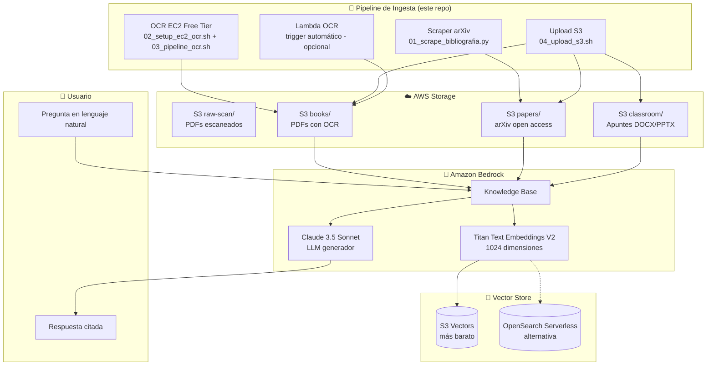

# Arquitectura del RAG

## Diagrama



## Componentes

### 1. Pipeline de ingesta (este repositorio)

| Script | Función |
|---|---|
| `01_scrape_bibliografia.py` | Descarga legalmente papers de arXiv (CLIP, SayCan, RT-2, PaLM-E) |
| `02_setup_ec2_ocr.sh` | Instala OCRmyPDF + Tesseract español en EC2 Amazon Linux 2023 |
| `03_pipeline_ocr.sh` | Corre OCR en batch sobre todos los PDFs de `raw-scan/` |
| `04_upload_s3.sh` | Sube a S3 sanitizando nombres (sin espacios/acentos/paréntesis) |
| `lambda/app.py` | Alternativa serverless: OCR automático en cada upload a `raw-scan/` |

### 2. Storage (S3)

- `raw-scan/` — PDFs escaneados pendientes de OCR
- `books/` — PDFs con texto seleccionable (originales + OCR)
- `papers/` — Papers de arXiv (open access)
- `classroom/` — Apuntes, diapositivas, código MATLAB exportado a PDF

### 3. Bedrock Knowledge Base

- **Embeddings**: Titan Text Embeddings V2 (1024 dims, $0.0001/1K tokens)
- **LLM**: Claude 3.5 Sonnet v2 (consultas RAG)
- **Chunking**: Default (300 tokens, 20% overlap)

### 4. Vector Store

- **Recomendado**: S3 Vectors (nuevo 2025, ~10× más barato que OpenSearch)
- **Alternativa**: OpenSearch Serverless (más features pero más caro)

## Flujo de una consulta

```
1. Usuario escribe: "¿Cómo se calcula el jacobiano de un brazo 3GDL?"
2. Bedrock genera embedding de la consulta (Titan V2)
3. Vector store busca los 5 chunks más similares (cosine similarity)
4. Bedrock arma prompt: "Contexto: <chunks>. Pregunta: <original>"
5. Claude 3.5 genera respuesta citando páginas
6. Respuesta regresa al usuario
```

Latencia total: ~2-4 segundos por consulta.
